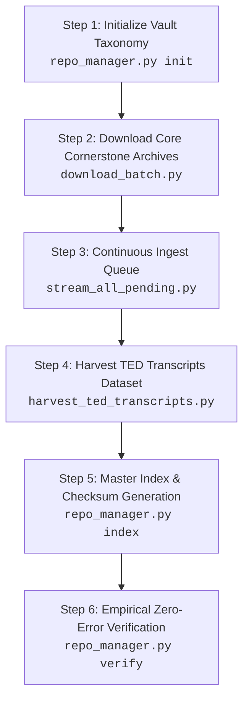

# Master Reference Manual: Duplicating KnowRepo1 on Other Machines & Devices

> **Knowledge Gathering System (KGS) — Reference Implementation & Source Duplication Guide**  
> **Repository:** [https://github.com/twan102000-Builder/knowledge-gathering-system](https://github.com/twan102000-Builder/knowledge-gathering-system)  
> **Target Repository Identifier:** `KnowRepo1` (Primary Offline Knowledge Vault)  
> **Document Purpose:** Complete, step-by-step technical standard operating procedure (SOP) to duplicate `KnowRepo1` onto new machine instances, external drives, and devices with identical Dewey taxonomy, identical download sources, and 100% error-free SHA-256 verification.

---

## 1. Executive Overview & Target State

The **Knowledge Gathering System (KGS)** builds a zero-local-disk-bloat, portable, offline knowledge repository. Content is acquired from authoritative open knowledge sources, staged temporarily in `/tmp/knowrepo_stage`, validated via SHA-256 checksums, and stored directly into an attached storage media vault (`~/KnowRepo1`).

When provisioning a new machine, device, or external storage drive from scratch, you have two duplication methodologies available:

| Methodology | Primary Use Case | Network Required | Expected Duration |
| :--- | :--- | :--- | :--- |
| **Method 1: Autonomous Source Ingestion** *(Recommended for fresh instances)* | Downloads all data directly from identical upstream source mirrors (Kiwix, Hugging Face, Project Gutenberg) into identical folder structures with fresh hashes and indexing. | High-speed Internet (100–120 GB data transfer) | 3–8 hours depending on bandwidth |
| **Method 2: High-Throughput Media Replication** | High-speed drive-to-drive mirroring from an existing `KnowRepo1` storage drive to a secondary drive (`KnowRepo2` / new device) via 16 MB buffered I/O. | None (100% offline) | 30–60 minutes over USB 3.0 / NVMe / SD card |

### Verified KnowRepo1 Baseline Metrics

An authentic, fully completed duplicate of `KnowRepo1` exhibits the following verified operational profile:

```
Total Files:             4,598 files
Total Data Footprint:    ~115.58 GB
Taxonomy Tiers:          8 categories (00 through 07)
Integrity Manifest:      SHA-256 master catalog covering every file
Database Engine:         SQLite 3 with Full-Text Search (FTS5)
Search UI:               Zero-dependency single-page offline HTML/JS catalog
```

---

## 2. Directory Hierarchy & Taxonomy Specifications

Every duplicate instance must recreate the exact Dewey-inspired folder taxonomy:

```text
~/KnowRepo1/
├── 00_Index_and_Manifests/
│   ├── INDEX.md                  # Human-readable master Markdown index
│   ├── index.html                # Zero-dependency offline interactive search portal
│   ├── MANIFEST.sha256           # Authoritative SHA-256 checksum list for bit-rot audits
│   ├── catalog.json              # Complete machine-readable asset catalog with metadata
│   └── kgs_metadata.db           # SQLite database tracking ingested clips, media & URLs
├── 01_Medical_and_Health/        # First aid, wilderness medicine, clinical guides, pharmacology
├── 02_Survival_and_Food/         # TruePrepper, foraging, water purification, agriculture
├── 03_Engineering_and_Repair/    # Project Gutenberg Class T (Technology), mechanical & solar guides
├── 04_Science_and_Reference/     # Project Gutenberg Class Q (Science) & Class L (Education), math, physics
├── 05_Computing_and_Comms/       # Stack Exchange archives, FreeCodeCamp courses, ArchWiki, Linux, networking
├── 06_History_Law_and_Civics/    # Project Gutenberg Class K (Law), TED Talks archives, philosophy, civics
│   └── ted_talks_transcripts/    # Curated offline archive of 2,293 TED Talks
│       ├── by_topic/             # 46 topic-classified subdirectories containing 4,586 Markdown transcripts
│       ├── ted_catalog.json      # Structured JSON registry of all talks with keywords and word counts
│       ├── ted_transcripts.sqlite3 # FTS5 full-text search SQLite database
│       └── README.md             # Collection navigation guide
└── 07_Uncategorized_Inbox/       # Staging landing zone for real-time ingestions
    ├── snippets/                 # Captured text selections and clipboard clips
    ├── media/                    # Captured diagrams, screenshots, and figures
    ├── daily/                    # Automated daily summary logs
    └── sd_imports/               # Automated camera/SD card import dump zone
```

---

## 3. Host System & Hardware Preparation

### 3.1 Hardware Storage Requirements
- **Drive Capacity:** Minimum 128 GB (256 GB recommended to allow headroom for future ingestions).
- **Media Types:** External USB 3.1/3.2 SSD, USB 3.0 Flash drive, or High-Speed UHS-I / V30 MicroSD card.
- **Filesystem Recommendation:**
  - **`exFAT` (Recommended for cross-platform portability):** Compatible across Linux, ChromeOS, macOS, Windows, Android, and iOS. Supports files > 4 GB (critical for monolithic ZIM archives like Gutenberg Class Q at 16.51 GB and Class T at 12.25 GB). Recommended cluster size: `128 KB` or `256 KB`.
  - **`ext4` (Linux-only environments & Raspberry Pi):** Provides native POSIX permissions and symbolic links.

### 3.2 Partitioning & Formatting on Linux / Raspberry Pi

If preparing a new physical disk or SD card:

```bash
# 1. Identify target block device (e.g., /dev/sda or /dev/mmcblk0)
lsblk -o NAME,PATH,RM,RO,SIZE,TYPE,FSTYPE,LABEL,MOUNTPOINT

# 2. Partition with GPT (replace /dev/sdX with your actual target drive)
sudo parted --script /dev/sdX mklabel gpt mkpart primary exfat 2048s 100%

# 3. Format with exFAT
sudo mkfs.exfat -n "KnowRepo1" /dev/sdX1

# 4. Create mount point and mount
sudo mkdir -p /media/$USER/KnowRepo1
sudo mount -o rw,uid=$(id -u),gid=$(id -g),umask=0022 /dev/sdX1 /media/$USER/KnowRepo1

# 5. Create persistent home symlink
ln -sfn /media/$USER/KnowRepo1 ~/KnowRepo1
```

### 3.3 ChromeOS (Crostini) Storage Passthrough

On ChromeOS Chromebooks:
1. Insert the external USB drive or SD card.
2. Open the ChromeOS **Files** app.
3. In the left panel, find the drive under **Removable**.
4. Right-click the drive $\rightarrow$ select **"Share with Linux"**.
5. Inside the Linux terminal, establish the standard symlink:
   ```bash
   ln -sfn "/mnt/chromeos/shared/removable/USB Drive" ~/KnowRepo1
   # Or for an SD card:
   # ln -sfn "/mnt/chromeos/shared/removable/SD Card" ~/KnowRepo1
   ```

### 3.4 Software Prerequisites

Install system utilities and Python dependencies on the target host:

```bash
# Debian / Ubuntu / Raspberry Pi OS / ChromeOS Crostini
sudo apt-get update && sudo apt-get install -y \
    python3 \
    python3-pip \
    curl \
    sqlite3 \
    git \
    rsync \
    util-linux

# Python library dependencies
pip3 install pyyaml pydantic rich
```

---

## 4. Setting Up the KGS Engine on the Target Machine

Clone the official Knowledge Gathering System repository:

```bash
git clone https://github.com/twan102000-Builder/knowledge-gathering-system.git ~/kgs
cd ~/kgs
```

### Path & Environment Configuration

The KGS automation suite defaults to `~/KnowRepo1`. If your storage mount is located elsewhere, you can configure it globally without modifying script files:

```bash
# Optional: Set custom vault location (if not using ~/KnowRepo1)
export KGS_REPO_ROOT="/media/$USER/KnowRepo1"
```

Verify that the staging directory `/tmp/knowrepo_stage` is writable:
```bash
mkdir -p /tmp/knowrepo_stage
```

---

## 5. Method 1: Full Reproduction from Download Sources

Follow this sequential pipeline to download and build a 100% identical, error-free copy of `KnowRepo1` directly from original source mirrors.



---

### Step 1: Initialize Vault Taxonomy

Run `repo_manager.py init` to provision the exact category hierarchy, inbox subdirectories, and master catalog skeleton:

```bash
python3 repo_manager.py --repo ~/KnowRepo1 init
```

**Output validation:**
This provisions:
- Categories `00_Index_and_Manifests` through `07_Uncategorized_Inbox`
- Subdirectories `07_Uncategorized_Inbox/{snippets,media,daily,sd_imports}`
- An initial baseline `catalog.json` and `kgs_metadata.db`

---

### Step 2: Download Core Cornerstone Archives (`download_batch.py`)

Run `download_batch.py` to ingest the largest foundational encyclopedias and curriculum collections:

```bash
python3 download_batch.py
```

#### What this step downloads:
1. **TruePrepper All Articles & Guides** (`02_Survival_and_Food`)
   - Source: `https://download.kiwix.org/zim/other/trueprepper.com_en_all_2026-05.zim` (~1.36 GB)
2. **FreeCodeCamp Full Courses** (`05_Computing_and_Comms`)
   - Source: `https://download.kiwix.org/zim/freecodecamp/freecodecamp_en_all_2026-08.zim` (~7.9 MB)
3. **Project Gutenberg Class K (Law & Civics)** (`06_History_Law_and_Civics`)
   - Source: `https://download.kiwix.org/zim/gutenberg/gutenberg_en_lcc-k_2026-03.zim` (~235 MB)
4. **TED Talks — WorkLife Collection** (`06_History_Law_and_Civics`)
   - Source: `https://download.kiwix.org/zim/ted/ted_mul_worklife_2026-09.zim` (~354 MB)
5. **TED Talks — Competition Collection** (`06_History_Law_and_Civics`)
   - Source: `https://download.kiwix.org/zim/ted/ted_mul_competition_2026-09.zim` (~114 MB)
6. **Project Gutenberg Class L (Education)** (`04_Science_and_Reference`)
   - Source: `https://download.kiwix.org/zim/gutenberg/gutenberg_en_lcc-l_2026-03.zim` (~600 MB)
7. **Project Gutenberg Class T (Technology & Engineering)** (`03_Engineering_and_Repair`)
   - Source: `https://download.kiwix.org/zim/gutenberg/gutenberg_en_lcc-t_2026-03.zim` (~12.25 GB)
8. **Project Gutenberg Class Q (Science)** (`04_Science_and_Reference`)
   - Source: `https://download.kiwix.org/zim/gutenberg/gutenberg_en_lcc-q_2026-03.zim` (~16.51 GB)

#### Built-in Safeguards:
- **Resumable Transfers:** Downloads via `curl -L -C - --retry 5 --retry-delay 3`. If interrupted, running the command again picks up at the exact byte offset where it left off.
- **Disk Safety Check:** Inspects free disk space prior to every item and requires `estimated size + 2.0 GB` of free space to avoid filling the disk.
- **Incremental Indexing:** Runs catalog sync after every archive download.

---

### Step 3: Continuous Ingest Queue (`stream_all_pending.py`)

Run `stream_all_pending.py` to ingest the remaining 188 curated reference packages:

```bash
python3 stream_all_pending.py
```

#### What this step downloads:
- **Queue Source:** Reads `pending_batch_queue.json` containing 208 targeted reference packages.
- **Volume:** Ingests **188 verified completed ZIM archives** totaling **~70.65 GB**:
  - `05_Computing_and_Comms` (~9.51 GB): Full offline Stack Overflow dumps (multi-language), AskUbuntu, SuperUser, ServerFault, ArchWiki, Termux, DevDocs offline bundles, FreeCodeCamp specific tracks (Algorithms, Project Euler, Responsive Web Design).
  - `06_History_Law_and_Civics` (~53.81 GB): Specialized legal, philosophical, and historical reference collections.
  - `04_Science_and_Reference` (~5.62 GB): Wikibooks science modules, specialized reference compendiums.
  - `01_Medical_and_Health` (~0.05 GB): Clinical reference manuals and emergency first aid databases.
  - `07_Uncategorized_Inbox` (~1.66 GB): Topical documentation packages.

#### Built-in Safeguards:
- **State Persistence (`batch_progress.json`):** Tracks status (`completed` or `failed`), downloaded byte size, category, and timestamps. If restarted, it checks existing files and skips already downloaded items.
- **Disk Space Governor:** If free storage drops below `5.0 GB`, the queue automatically pauses and flushes current catalogs safely.
- **404 / Broken URL Tolerance:** 13 upstream URLs that have been retired or renamed on Kiwix mirrors (e.g., outdated slugs like `php.net_en_all_2024-08` or `sh1.org`) are marked as `failed` and logged without crashing the runner or halting other downloads.

---

### Step 4: TED Talks Transcripts Harvester (`harvest_ted_transcripts.py`)

Run `harvest_ted_transcripts.py` to acquire and classify the complete offline TED Talks transcripts dataset:

```bash
python3 harvest_ted_transcripts.py
```

#### What this step accomplishes:
1. **Source Connection:** Queries the Hugging Face REST API (`vietgpt/ted_talks_iwslt_en` dataset split).
2. **Talk Ingestion:** Downloads all **2,293 curated English TED Talks**.
3. **Automated Keyword Classification:** Evaluates each talk against the 46 designated topic taxonomies:
   > `inclusion`, `wildlife`, `life`, `play`, `ai`, `pandemic`, `capitalism`, `emotions`, `leadership`, `conservation`, `tech`, `family`, `performance`, `sustainability`, `money`, `relationships`, `microbes`, `blockchain`, `policy`, `energy`, `human-rights`, `community`, `business`, `democracy`, `innovation`, `agriculture`, `society`, `pollution`, `investing`, `data`, `travel`, `law`, `entrepreneur`, `machine-learning`, `humanity`, `trees`, `success`, `algorithm`, `vulnerability`, `empathy`, `friendship`, `communication`, `cryptocurrency`, `nature`, `pain`, `electricity`.
4. **Clean File Generation:**
   - Generates **4,586 individual clean Markdown files** placed into `~/KnowRepo1/06_History_Law_and_Civics/ted_talks_transcripts/by_topic/<topic>/`.
   - Generates `ted_transcripts.sqlite3` with an active FTS5 (Full-Text Search 5) index.
   - Generates `ted_catalog.json` and a collection `README.md`.
5. **Incremental Catalog Sync:** Triggers `repo_manager.py index` to register all newly created files into the master repository manifests.

---

### Step 5: Master Indexing, Cataloging & SHA-256 Manifest Generation

Once all downloads are complete, rebuild the master manifests and generate authoritative SHA-256 integrity checksums across the entire vault:

```bash
python3 repo_manager.py --repo ~/KnowRepo1 index
```

#### Generated Manifest Artifacts:
- **`00_Index_and_Manifests/INDEX.md`**: Master markdown catalog broken down by category with file links, sizes, and file counts.
- **`00_Index_and_Manifests/index.html`**: Zero-dependency offline single-page web app. Features real-time client-side search, category dropdowns, format filters (MD, TXT, PDF, EPUB, ZIM), and direct file links.
- **`00_Index_and_Manifests/MANIFEST.sha256`**: Exact SHA-256 checksum for every file in the repository (excluding `00_Index_and_Manifests`).
- **`00_Index_and_Manifests/catalog.json`**: Complete structured JSON catalog with titles, source URLs, checksums, modification dates, and byte counts.

---

### Step 6: Empirical Zero-Error Verification

To guarantee that the newly created repository has zero corruption, missing files, or bit-rot, execute the verification suite:

```bash
# 1. Run SHA-256 manifest verification
python3 repo_manager.py --repo ~/KnowRepo1 verify
```

Expected output:
```text
[+] Verification complete: 4598 OK, 0 FAILED.
```

Next, verify SQLite database integrity:
```bash
# 2. Check metadata database
sqlite3 ~/KnowRepo1/00_Index_and_Manifests/kgs_metadata.db "PRAGMA integrity_check;"
# Output must be: ok

# 3. Check TED transcripts database
sqlite3 ~/KnowRepo1/06_History_Law_and_Civics/ted_talks_transcripts/ted_transcripts.sqlite3 "PRAGMA integrity_check;"
# Output must be: ok
```

---

## 6. Method 2: High-Speed Drive-to-Drive Media Duplication

If you already have a physical drive containing an initialized `KnowRepo1` and want to duplicate it onto another drive or machine **without re-downloading ~115 GB over the internet**, use [`duplicate_repo.py`](file:///home/twan102000/Knowledge%20Gathering%20for%20Local%20Repository/duplicate_repo.py).

### How It Works
- **16 MB Buffered Sequential Transfers:** Optimized for removable media, SD card controllers, and 9p virtualization layers.
- **Resumable:** Scans the destination first and skips files that already exist with identical size.
- **Periodic Disk Sync:** Employs `os.fdatasync` every 128 MB to avoid kernel dirty-buffer buildup.
- **Category-by-Category Post-Audit:** Verifies file count and size matching across all 8 taxonomy tiers.

### Duplication Commands

```bash
# Clone from primary drive to a secondary drive (e.g., KnowRepo2)
python3 duplicate_repo.py --src ~/KnowRepo1 --dst ~/KnowRepo2 --buffer-mb 16

# Clone from a source mount to a specific target mount
python3 duplicate_repo.py --src /media/$USER/KnowRepo1 --dst /media/$USER/NewDrive/KnowRepo1

# Audit / Verification only (no copying)
python3 duplicate_repo.py --verify-only --src ~/KnowRepo1 --dst ~/KnowRepo2
```

---

## 7. Troubleshooting & Operational Runbook

### Issue A: Interrupted Network Connection
- **Symptom:** `curl` exits with error code 18 or 28 during a multi-gigabyte ZIM download.
- **Resolution:** Simply re-run `python3 stream_all_pending.py` or `python3 download_batch.py`. Because `curl -C -` is active, it automatically resumes downloading from the exact byte where it paused.

### Issue B: Low Free Disk Space Warning
- **Symptom:** `[ALERT] Free disk space is low (< 5.00 GB). Pausing queue to prevent drive fill.`
- **Resolution:** Check storage usage with `df -h ~/KnowRepo1`. If using an external drive, ensure you formatted and mounted the large capacity partition rather than the host internal root filesystem (`/`).

### Issue C: Incomplete Stub Files (< 2048 bytes)
- **Symptom:** A download failed early and left an invalid HTML error page as a `.zim` file.
- **Resolution:** The scripts automatically detect and delete files under 2,048 bytes on error. To manually purge any zero-byte or stub files:
  ```bash
  find ~/KnowRepo1 -type f -size -2k -name "*.zim" -delete
  ```

### Issue D: Safe Ejection of Storage Media
To prevent bit corruption when unmounting from the host device:
```bash
# 1. Flush kernel disk write caches
sync

# 2. Check for open file handles
lsof ~/KnowRepo1 2>/dev/null || true

# 3. Safely unmount (Linux)
sudo umount ~/KnowRepo1
# Or on ChromeOS: Click Eject (⏏) in the Files app.
```

---

## 8. Multi-Device Client Usage

Once duplicated, the repository can be used on any device completely offline:

### Client Mode 1: Offline Browser Portal
Double-click `~/KnowRepo1/00_Index_and_Manifests/index.html` in Chrome, Firefox, Safari, or Edge. You can search, filter by category, and read articles with zero network connectivity.

### Client Mode 2: Kiwix Offline Reader (`.zim` Archives)
Open `.zim` archives with [Kiwix](https://www.kiwix.org/):
- **Android / iOS:** Install Kiwix, grant storage permission to the SD card/USB drive, and select the `.zim` file.
- **Linux / macOS / Windows:** Launch Kiwix Desktop and open any archive from `02_Survival_and_Food`, `03_Engineering_and_Repair`, `04_Science_and_Reference`, `05_Computing_and_Comms`, or `06_History_Law_and_Civics`.

### Client Mode 3: Local Network Field Hotspot
To share the entire knowledge base with phones, tablets, and laptops over an offline local Wi-Fi router or hotspot:
```bash
cd ~/KnowRepo1/00_Index_and_Manifests
python3 -m http.server 8080 --bind 0.0.0.0
```
Any client on the local network navigates to `http://<HOST-IP>:8080` to search and access materials.

### Client Mode 4: KGS Command Suite Integration
```bash
# Search articles, notes, and records
python3 src/cli.py search "first aid"

# Ingest new articles into Category 01 (Medical) on the duplicated vault
python3 src/cli.py ingest "https://example.com/hypothermia-protocol" -c 01 -f md

# Verify ongoing data integrity against bit-rot
python3 src/cli.py verify
```

---

## 9. Replication Checklist Summary

When setting up a new device, use this concise checklist:

- [ ] Storage medium formatted as `exFAT` (or `ext4`) with $\ge 150\text{ GB}$ free space.
- [ ] Mount point established and symlinked to `~/KnowRepo1`.
- [ ] KGS repository cloned: `git clone https://github.com/twan102000-Builder/knowledge-gathering-system.git`.
- [ ] Python dependencies installed: `pip3 install pyyaml pydantic rich`.
- [ ] Vault initialized: `python3 repo_manager.py --repo ~/KnowRepo1 init`.
- [ ] Cornerstone collections downloaded: `python3 download_batch.py`.
- [ ] Complete ZIM queues streamed: `python3 stream_all_pending.py`.
- [ ] TED Talks transcripts harvested & classified: `python3 harvest_ted_transcripts.py`.
- [ ] Master indexes and manifests regenerated: `python3 repo_manager.py --repo ~/KnowRepo1 index`.
- [ ] Full integrity verified: `python3 repo_manager.py --repo ~/KnowRepo1 verify` (0 failures).
- [ ] Database PRAGMAs verified: `PRAGMA integrity_check;` returns `ok`.
